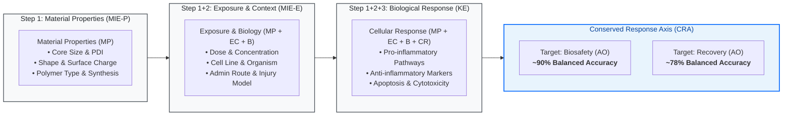

<div align="center">

# NeuroSafeNet
### Conserved Biological Response States Organize Nanoparticle Biosafety Across Neurological Systems

[](https://www.python.org/downloads/)
[](https://opensource.org/licenses/MIT)
[](https://scikit-learn.org/)
[](https://hydra.cc/)
[](https://github.com/anblabs/NeuroSafeNet)

<p align="center">
  <b>A unified, mechanistically interpretable machine-learning framework decoding nanoparticle biosafety and therapeutic recovery through the Adverse Outcome Pathway (AOP) cascade.</b>
</p>

[Overview](#-overview) •
[Key Discoveries](#-key-discoveries--validation) •
[Feature Architecture](#-feature-architecture--aop-framework) •
[Repository Structure](#-repository-structure) •
[Quickstart](#-quickstart--installation) •
[Workflow](#️-usage--workflow) •
[Model Benchmarks](#-model-benchmarks--performance) •
[Citation](#-citation)

</div>

---

## 📖 Overview

Predicting the biological safety and therapeutic recovery outcomes of engineered nanomaterials remains a major challenge in nanomedicine and regulatory toxicology due to physicochemical diversity, experimental heterogeneity, and context-dependent nano–bio interactions.

**NeuroSafeNet** implements an integrative, hierarchical machine-learning and data curation framework designed to decode and predict nanoparticle biosafety and recovery across heterogeneous biological systems (spanning *in vitro* and *in vivo* neurological models, and cross-organ liver and lung systems).

Through the synthesis of **599 original reports** encompassing **893 experimental contexts**, this framework introduces the **Conserved Response Axis (CRA)**—a unified, mechanistically interpretable biological space organized by three foundational programmes:
1. **Pro-inflammatory signaling** (e.g., TNF-α, IL-1β, IL-6, NF-κB, p38 MAPK)
2. **Anti-inflammatory & resolution pathways** (e.g., IL-10, TGF-β, SOCS family)
3. **Apoptosis-associated responses** (e.g., Caspase-3/8/9, Cyt-c, BAX/BCL-2)



---

## 🔬 Manuscript Summary & Scientific Highlights

### Title
> **Conserved biological response states organize nanoparticle biosafety across neurological systems**

### Authors
Sri Renukadevi Balusamy$^{1\#}$, Davoodbasha Mubarak Ali$^{2,3\#}$, Irfan Ullah$^{4}$, Girish Birappa$^{5}$, Samad Abdus$^{6}$, Priyanka Singh$^{7}$, Shadi Rahimi$^{8}$, Sumit Kumar$^{9}$, Mamata Karmacharya$^{9}$, Yeon Ju Kim$^{6}$, Suresh Ramakrishna$^{5,10}$, Ivan Mijakovic$^{8,11}$, Seungae Lee$^{12}$, Haribalan Perumalsamy$^{13,14\#*}$

$^\#$*These authors contributed equally*  
$^*$**Corresponding authors:**
* Haribalan Perumalsamy ([harijai2004@hanyang.ac.kr](mailto:harijai2004@hanyang.ac.kr))
* Sumit Kumar ([sumitwithchem@gmail.com](mailto:sumitwithchem@gmail.com))
* Seungah Lee ([moon11311@naver.com](mailto:moon11311@naver.com))

### Affiliations
1. Department of Food Science and Biotechnology, Sejong University, Seoul, Republic of Korea
2. School of Life Sciences, B.S. Abdur Rahman Crescent Institute of Science and Technology, Chennai, India
3. Centre Surface Technology and Applications, Korea Aerospace University, Goyang-si, Republic of Korea
4. Department of Computer Science and Engineering, Kyung Hee University (Global Campus), Yongin, South Korea
5. Graduate School of Biomedical Science and Engineering, Hanyang University, Seoul, Republic of Korea
6. Graduate School of Biotechnology, College of Life Science, Kyung Hee University, Yongin-Si, Republic of Korea
7. Department of Health Technology, Technical University of Denmark, Kongens Lyngby, Denmark
8. Division of Systems and Synthetic Biology, Chalmers University of Technology, Gothenburg, Sweden
9. Department of Biomedical Engineering, Ulsan National Institute of Science and Technology (UNIST), Ulsan, South Korea
10. College of Medicine, Hanyang University, Seoul, South Korea
11. The Novo Nordisk Foundation Biotechnology Research Institute for the Green Transition, Technical University of Denmark, Kongens Lyngby, Denmark
12. Department of Applied Chemistry and Institute of Natural Sciences, Kyung Hee University, Yongin-si, Republic of Korea
13. Center for Creative Convergence Education, Hanyang University, Seoul, Republic of Korea
14. Research Institute for Convergence of Basic Science, Hanyang University, Seoul, Republic of Korea

### Key Discoveries & Validation
* **Predictive Generalization via Hierarchical Integration:** Models incorporating biological response programmes (Step 1+2+3) significantly outperform purely physicochemical models (Step 1; Balanced Accuracy rose from 66% to 90% for biosafety, and 64% to 78% for recovery).
* **SHAP Feature Attribution:** Tree-based SHAP and ensemble interpretability identify pro-inflammatory and apoptosis-associated programmes as the dominant predictive drivers of biosafety and recovery classification.
* **Orthogonal Experimental Validation:** Evaluated using solution plasma-synthesized cellulose–cobalt nanocomposites (CxCoy) in IFN-$\gamma$-induced BV2 microglial neuroinflammation, measuring cell viability (MTT), nitric oxide (Griess), NF-$\kappa$B p65 / NOTCH2 translocation, ROS generation, and Annexin V/PI flow cytometry.
* **Functional Uptake Regulation:** Endocytic inhibition (Chlorpromazine & Methyl-$\beta$-cyclodextrin) coupled with quantitative ICP–MS confirmed that intracellular nanoparticle internalization directly drives state transitions along the CRA.
* **Cross-Scale & Cross-Organ Generalization:** Conserved response patterns validated across 3D biomimetic microglial spheroids, neurological disease transcriptomics (Alzheimer's disease [GSE142066], Multiple Sclerosis [GSE244966], Traumatic Brain Injury [GSE306006]), and cross-organ systems (Liver: GSE43515, GSE55286; Lung: GSE259384, GSE280933) across diverse nanomaterial classes (Carbon black, MWCNTs, AgNPs, Lipid Nanoparticles).

---

## 🧬 Feature Architecture & AOP Framework

The dataset and modeling pipeline adhere to the **Adverse Outcome Pathway (AOP)** structure:

| Feature Tier | Code / Acronym | Definition & Formulation | Variables & Biological Parameters |
| :--- | :--- | :--- | :--- |
| **Tier 1** | **`MIE-P`** | **`MP`** *(Material Properties)* | Physicochemical attributes: Core Size, Hydrodynamic Diameter, Shape, Surface Charge, PDI, Polymer Type, Synthesis Method. |
| **Tier 2** | **`MIE-E`** | **`MP + EC + B`** *(Exposure & Context)* | Material Properties (`MP`) + Exposure Conditions (`EC`: concentration, stimulant, exposure duration, dose regimen) + Biological Model (`B`: cell type, species, sex, age, administration route, injury model). |
| **Tier 3** | **`KE`** | **`CR`** *(Cellular Response)* | Key Events measuring downstream mechanistic responses (% toxicity, cellular viability, uptake, inflammatory cascade activation). |
| **Target** | **`AO`** | **Adverse Outcome** | Ultimate binary classification targets: **`AO_Biosafety`** and **`AO_Recovery`** (*Good* vs. *Bad*). |

> [!NOTE]
> **Dataset File Structure:** The primary dataset file [`Data/Final_dataset.xlsx`](Data/Final_dataset.xlsx) contains two worksheets:
> 1. **`Final_dataset`**: The curated experimental data matrix across 893 contexts.
> 2. **`Important Note`**: Reference guide defining all AOP feature acronyms (`MIE-P = MP`, `MIE-E = MP + EC + B`, `KE = CR`, `AO = Biosafety/Recovery`).

---

## 📁 Repository Structure

```text
NeuroSafeNet/
├── configs/                              # Modular Hydra / OmegaConf configurations
│   ├── config.yaml                       # Master training & cross-validation configuration
│   ├── paths.py                          # Dynamic path resolver
│   ├── settings.py                       # Global ML hyperparameters (n_splits=10, random_state=42)
│   ├── data/
│   │   ├── data.yaml                     # Active dataset and feature column selection
│   │   └── aop_biosafety_example.yaml    # Preconfigured AOP biosafety experiment spec
│   ├── io/
│   │   └── io.yaml                       # Output folder naming & export flags
│   ├── preprocessing/
│   │   └── preprocessing.yaml            # Imputation and categorical encoding rules
│   └── split/
│       └── split.yaml                    # Stratified train/internal/external split ratios
├── Data/
│   └── Final_dataset.xlsx                # Harmonized dataset with 'Important Note' sheet
├── outputs/                              # Generated artifacts, models, and predictions
│   ├── metrics_summary.csv               # Complete benchmark performance across all models
│   ├── preprocessed_Model_3/             # Processed NumPy feature matrices & encoders
│   └── training_Model_3/                 # Model binaries, CV summaries, and predictions
├── src/
│   ├── constants.py
│   ├── ninflam/                          # Core NeuroSafeNet Python package
│   │   ├── cli.py                        # CLI entrypoint (ninflam-prep)
│   │   ├── pre_pipeline.py               # Preprocessing orchestration pipeline
│   │   ├── config/                       # Dataclass schemas
│   │   ├── core/                         # Custom exceptions & logging handlers
│   │   ├── data/                         # Excel loaders, cleaners, and normalizers
│   │   ├── io/                           # Model serializers and artifacts managers
│   │   ├── pipeline/                     # Training & 10-fold cross-validation pipeline
│   │   ├── pre_train/                    # Imputers, encoders, and scalers
│   │   └── splitting/                    # Stratified splitting algorithms
│   ├── evaluation/                       # Evaluation & safe probability prediction routines
│   ├── feat/                             # Feature extraction utilities
│   ├── models/                           # Registry for model instances
│   └── trainer/                          # Training wrappers
├── main_preprocess.py                    # Preprocessing execution script
├── main_train.py                         # Model training & benchmark summary execution script
├── pyproject.toml                        # Package dependencies & metadata
├── requirements.txt                      # PIP requirements
└── README.md                             # Project documentation
```

---

## 🚀 Quickstart & Installation

### Prerequisites
* Python $\ge$ 3.9
* Git

### 1. Clone the Repository
```bash
git clone https://github.com/anblabs/NeuroSafeNet.git
cd NeuroSafeNet
```

### 2. Set Up Virtual Environment
```bash
# Windows
python -m venv .venv
.\.venv\Scripts\activate

# Linux / macOS
python3 -m venv .venv
source .venv/bin/activate
```

### 3. Install Package & Dependencies
```bash
pip install --upgrade pip
pip install -r requirements.txt
pip install -e .
```

*Optional high-performance gradient boosting libraries:*
```bash
pip install xgboost catboost
```

---

## ⚙️ Configuration

The pipeline uses modular YAML configuration files located in `configs/`:

* **`configs/config.yaml`**: Controls training mode, 10-fold cross-validation, and active model algorithms:
  ```yaml
  log_level: INFO
  training:
    use_kfold: true
    n_splits: 10
    models:
      - RF
      - XGBoost
      - CatBoost
      - SVM
      - MLP
      - LogisticRegression
      - DecisionTree
      - KNN
      - LDA
      - NaiveBayes
    min_class_count: 2
  ```
* **`configs/data/data.yaml`**: Configures dataset file (`Final_dataset.xlsx`), target endpoint (`AO_Biosafety` or `AO_Recovery`), and active input features.
* **`configs/split/split.yaml`**: Configures stratified external (20%) and internal (20%) test splits.
* **`configs/io/io.yaml`**: Controls output directory tagging and artifact export options.

---

## 🛠️ Usage & Workflow

### Step 1: Data Preprocessing
Cleans raw literature-curated matrices, handles missing data via stratified imputers, encodes categorical descriptors, performs stratified partitioning, and exports serializable feature artifacts:

```bash
python main_preprocess.py
```
*Or via CLI:*
```bash
ninflam-prep --mode preprocess
```

> [!TIP]
> **Generated Preprocessing Artifacts (`outputs/preprocessed_Model_3/...`):**
> * `splits.npz`: Feature matrices (`X_tr`, `X_int`, `X_ext`, `y_tr`, `y_int`, `y_ext`)
> * `feature_names.npy`: Array of transformed feature identifiers
> * `labels_encoded.npz`: Encoded class mappings (`Good` / `Bad`)
> * `preprocessor.joblib`: Serialized imputation and transformation pipeline

---

### Step 2: Model Training & Evaluation
Trains benchmarked classifiers, executes stratified 10-fold cross-validation, saves fitted models, evaluates external holdout test data, and formats a console comparison table:

```bash
python main_train.py
```
*Or via CLI:*
```bash
ninflam-prep --mode train
```

**Console Output:**
Upon completion, `main_train.py` prints the consolidated performance table directly to the console:
```text
====================================================================================================================================
                                     ALL MODEL EVALUATION & BENCHMARK METRICS
====================================================================================================================================
Model Name           | 10-Fold CV Acc     | CV Bal Acc   | CV Prec    | CV Rec     | CV F1      | Test Acc   | Test F1   
------------------------------------------------------------------------------------------------------------------------------------
RF (Best CV Acc)     | 85.71% ± 3.40%     |     82.50%   |    84.12%  |    82.50%  |    83.15%  |    85.71%  |    78.79%
XGBoost (Best CV F1) | 89.80% ± 2.90%     |     86.40%   |    88.20%  |    86.40%  |    85.80%  |    89.80%  |    85.80%
CatBoost             | 81.63% ± 4.10%     |     78.20%   |    80.10%  |    78.20%  |    79.05%  |    81.63%  |    72.73%
...
====================================================================================================================================
👉 BEST OVERALL MODEL (by 10-Fold CV Accuracy): XGBoost (89.80% ± 2.90%)
👉 BEST MODEL (by 10-Fold CV Macro F1):        XGBoost (85.80%)
👉 BEST MODEL (by Test Split Accuracy):         XGBoost (89.80%)
```

> [!TIP]
> **Generated Training Artifacts (`outputs/training_Model_3/...`):**
> * `metrics_summary.csv`: Consolidated summary table across all models.
> * `models/*.joblib`: Serialized classifier binaries (`RF.joblib`, `SVM.joblib`, etc.).
> * `metrics/*.json`: Full classification reports (precision, recall, support per class).
> * `predictions/*.csv`: Sample-by-sample ground truth vs predicted class probabilities.
> * `cross_validation/*_cv_summary.csv`: Summary metrics across 10 folds.
> * `run_metadata.json`: Complete experiment tracking log and metadata.

---

## 📊 Model Benchmarks & Performance

### 10-Fold Cross-Validation & External Test Results (Representative Top Models)

| Target Endpoint | Model | Test Accuracy | Macro F1 | ROC-AUC | OOF Accuracy (CV) | OOF Macro F1 |
| :--- | :--- | :---: | :---: | :---: | :---: | :---: |
| **Biosafety** | **XGBoost** | **89.80%** | **0.8580** | **0.9369** | **90.21%** | **0.8712** |
| | **Random Forest (RF)** | 85.71% | 0.7879 | 0.9257 | 91.75% | 0.8922 |
| | **CatBoost** | 81.63% | 0.7273 | 0.9234 | 92.27% | 0.8983 |
| | **SVM (RBF)** | 87.76% | 0.8242 | 0.9234 | 89.69% | 0.8653 |
| | **Logistic Regression** | 85.71% | 0.7879 | 0.9099 | 90.72% | 0.8787 |
| **Recovery** | **Random Forest (RF)** | **87.76%** | **0.7500** | **0.8361** | **88.66%** | **0.8140** |
| | **CatBoost** | 87.76% | 0.7759 | 0.8056 | 87.63% | 0.7925 |
| | **Logistic Regression** | 87.76% | 0.7759 | 0.8250 | 85.57% | 0.7681 |
| | **XGBoost** | 83.67% | 0.7012 | 0.7833 | 86.60% | 0.7852 |

---

## 📜 Citation

If you use **NeuroSafeNet**, the **Conserved Response Axis (CRA)** framework, or the curated dataset in your research, please cite:

```bibtex
@article{balusamy2026conserved,
  title={Conserved biological response states organize nanoparticle biosafety across neurological systems},
  author={Balusamy, Sri Renukadevi and Ali, Davoodbasha Mubarak and Ullah, Irfan and Birappa, Girish and Abdus, Samad and Singh, Priyanka and Rahimi, Shadi and Kumar, Sumit and Karmacharya, Mamata and Kim, Yeon Ju and Ramakrishna, Suresh and Mijakovic, Ivan and Lee, Seungae and Perumalsamy, Haribalan},
  journal={Preprint / Under Review},
  year={2026}
}
```

---

## 📬 Contact & Support

For technical questions regarding the code, data pipelines, or models, please open an issue or contact:
* **Haribalan Perumalsamy:** [harijai2004@hanyang.ac.kr](mailto:harijai2004@hanyang.ac.kr)
* **Sumit Kumar:** [sumitwithchem@gmail.com](mailto:sumitwithchem@gmail.com)
* **Seungah Lee:** [moon11311@naver.com](mailto:moon11311@naver.com)

---

<div align="center">
  <sub>NeuroSafeNet — Advanced Machine Learning for Nanomedicine and Neuroinflammation Safety.</sub>
</div>
